# Biocrude from Cattle Manure: HTL Process Model and LCA

Process model, life cycle inventory and life cycle assessment of **biocrude production from livestock manure in Germany by hydrothermal liquefaction (HTL)**, rebuilt from my MSc thesis as reusable data, Python code and charts.

> **Komal Mallesh Chougule**, *Life cycle assessment of Biocrude Production from Livestock manure in Germany via Hydrothermal Liquefaction*. MSc thesis, Groundwater Management, TU Bergakademie Freiberg, 2022. Supervisors: Prof. Dr. J. Bongaerts, Dr. M. Alherbawi.

## The study in one picture

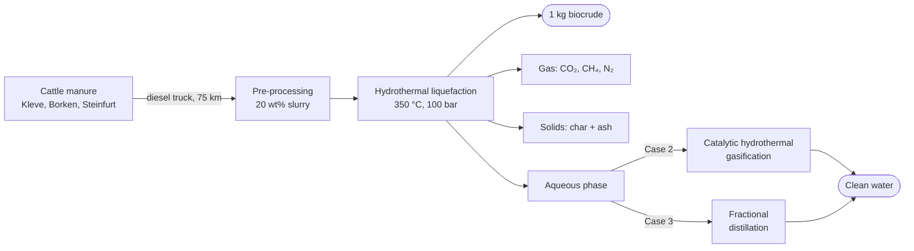

Three process configurations were modelled in **Aspen Plus**, each with wind or German grid electricity, and assessed in **GaBi 9.1** with **CML 2001** for a functional unit of **1 kg of biocrude**, cradle to gate.

## Key results

| Per 1 kg of bio-oil | Case 1: HTL | Case 2: HTL + HTG | Case 3: HTL + FD |
|---|---:|---:|---:|
| GWP, wind electricity (kg CO₂ eq) | **1.26** | 1.36 | 1.27 |
| GWP, German grid (kg CO₂ eq) | 1.67 | 1.78 | 1.68 |
| Acidification, wind / grid (g SO₂ eq) | 0.35 / 0.91 | 0.35 / 0.91 | 0.35 / 0.91 |
| Eutrophication, wind / grid (g PO₄ eq) | 0.085 / 0.187 | 0.085 / 0.187 | 0.085 / 0.187 |
| Freshwater ecotoxicity, wind / grid (g DCB eq) | 0.89 / 1.46 | 0.89 / 1.46 | 0.89 / 1.46 |

- **Biocrude yield:** 27.6% of the dry manure, with an HHV of 39.1 MJ/kg in Aspen Plus. The plant makes 4,888 kg/h from 2,000 t/day of wet manure.
- **The HTL conversion step causes 62–88% of the climate impact.** Grid electricity adds about 0.4 kg CO₂ eq.
- **Diesel trucks dominate acidification, eutrophication and toxicity** when the electricity comes from wind.
- **Treating the aqueous phase** recovers about 99% of it as clean water (COD < 250 mg/L). Distillation (case 3) adds less to GWP than gasification (case 2).

## Charts

Run `python make_charts.py` to redraw these in [`results/charts/`](results/charts/).

| | |
|---|---|
| 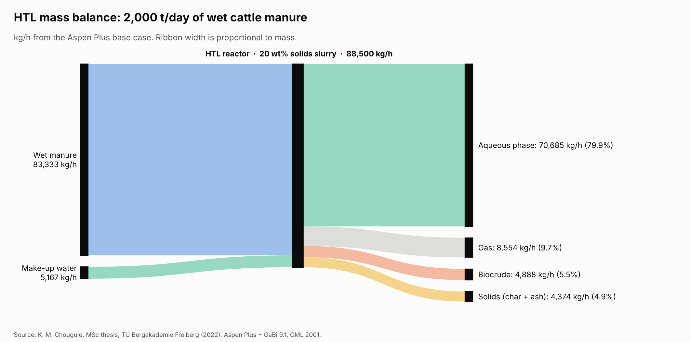 | 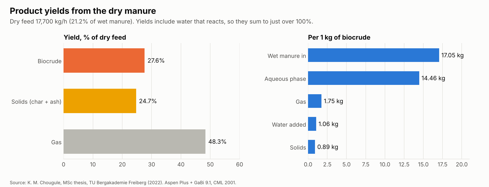 |
| 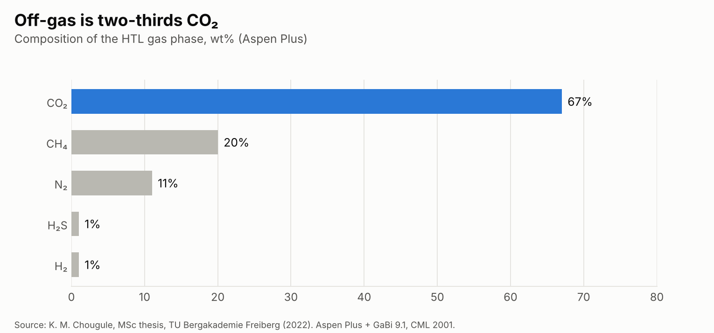 | 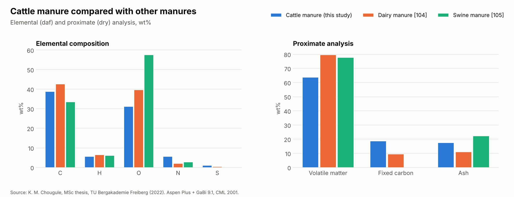 |
| 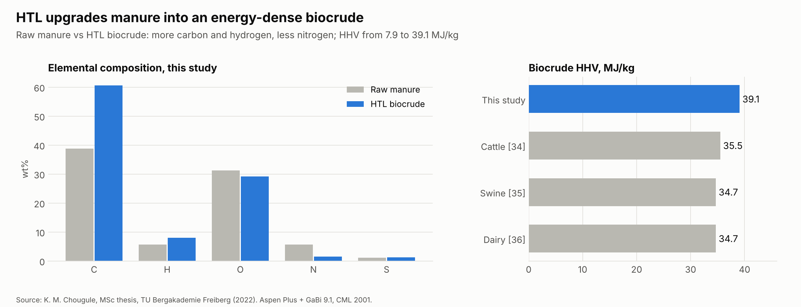 | 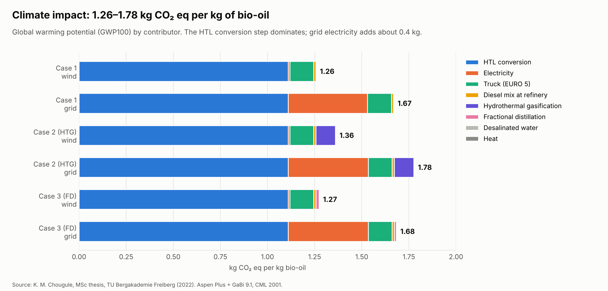 |
| 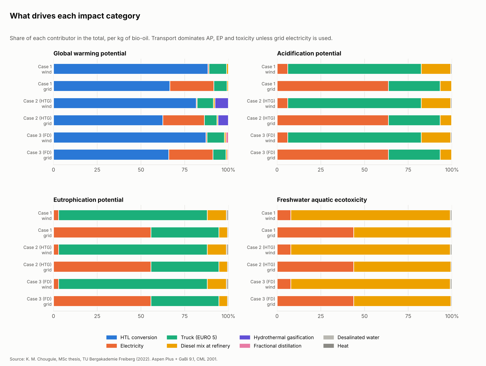 | 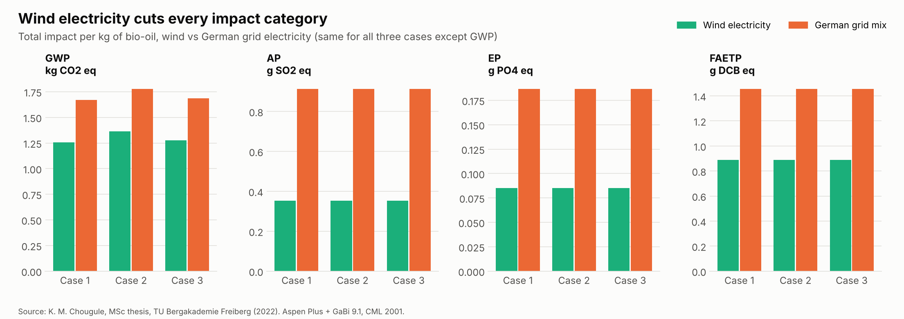 |
| 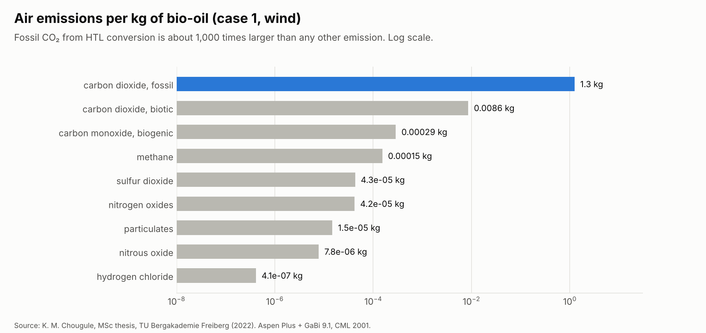 | 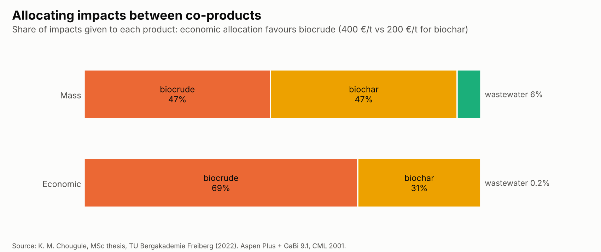 |
| 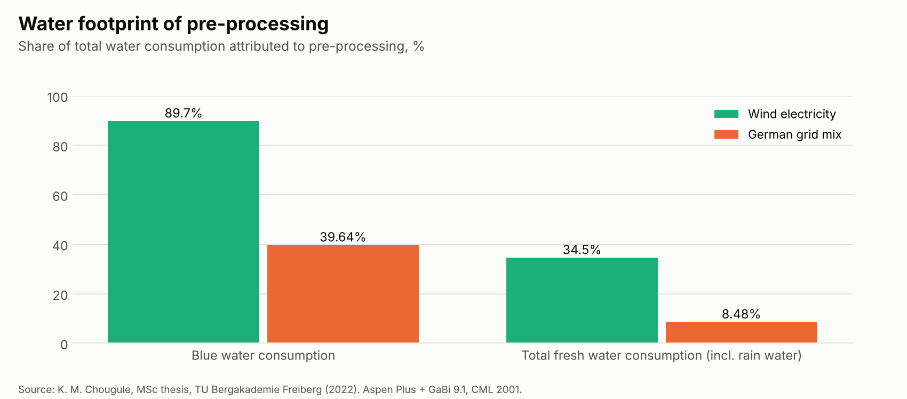 | 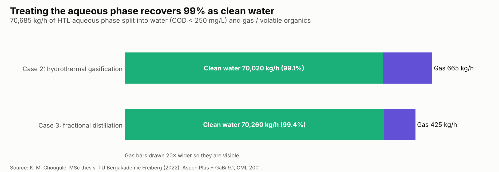 |

## Aspen Plus process models

The three flowsheets are documented in [`aspen/`](aspen/): block-by-block descriptions, stream table, operating conditions, the DECOMPOS Fortran calculator, and redrawn flowsheets.

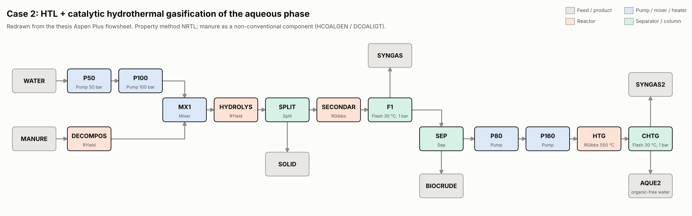

## Life cycle inventory

| File | Contents |
|---|---|
| [`data/thesis_tables/lci_per_kg_biooil.csv`](data/thesis_tables/lci_per_kg_biooil.csv) | Inventory per 1 kg bio-oil exactly as in thesis Table 4.4 |
| `results/lci_<case>_<electricity>.csv` | Inventory for each of the 6 scenarios, recomputed from the Aspen mass balance, with the GaBi background process for each input |
| [`data/thesis_tables/lcia_contributions.csv`](data/thesis_tables/lcia_contributions.csv) | Impact results by contributor, all scenarios and categories |
| [`data/thesis_tables/lcia_table_4_1_as_printed.csv`](data/thesis_tables/lcia_table_4_1_as_printed.csv) | Thesis Table 4.1 exactly as printed |
| [`data/thesis_tables/`](data/thesis_tables/) | Also: manure analysis, operating conditions, mass balances, off-gas, biocrude properties, air and water emissions, allocation, water footprint |

## Quick start

```bash
python -m venv .venv && source .venv/bin/activate   # Windows: .venv\Scripts\activate
pip install -r requirements.txt
python run.py          # mass balance, 6 scenario inventories, impact totals, data checks
python make_charts.py  # the 12 charts
pytest                 # 11 tests
```

`htlmodel.mass_balance.htl_balance(feed_t_per_day=...)` scales the Aspen base case to any plant size.

## Data checks

Rebuilding the thesis as code makes every number traceable. `run.py` writes [`results/data_checks.csv`](results/data_checks.csv). These are the points worth correcting or clarifying in any future paper based on this work:

| Topic | Finding |
|---|---|
| Biocrude yield basis | 4,887.52 kg/h is 27.6% of the **dry** feed (33.5% dry ash-free). The text calls 27.7–27.9% "daf". |
| Daily output | 4,887.52 kg/h is 117.3 **t/day**, not 117,301 t/day. |
| Gas in the LCI | The mass balance gives 1.75 kg gas per kg bio-oil; Table 4.4 lists 0.64 kg. Its yield labels for gas and biochar are swapped. |
| Impact table | A few rows of Table 4.1 have the diesel-mix and truck columns swapped. With one consistent assignment every printed total is reproduced within 0.3%. |
| Grid GWP | Table 4.1 gives 1.67 kg CO₂ eq; Section 4.6 says 1.76. |
| Biocrude HHV | Aspen reports 39.1 MJ/kg. The Channiwala equation (thesis Eq. 2) on the reported composition gives 27.7 MJ/kg. |
| DECOMPOS code | Table 3.2.1 has no sulfur line, so the yields sum to 0.998. |
| Conditions | 350 °C / 100 bar (Table 3.2.2) vs 300 °C / 175 bar for the RGibbs reactor (Section 3.2). |

## Project structure

```
aspen/               Aspen Plus flowsheets, block and stream tables, Fortran calculator
data/thesis_tables/  every table of the thesis as CSV
src/htlmodel/        mass_balance.py, lca.py, checks.py
tests/               pytest checks (mass balance, yields, impact totals)
results/             scenario inventories, impact totals, data checks, charts/
run.py               rebuild inventories and run checks
make_charts.py       draw the 12 charts
```

## Licence

- **Code:** MIT. See [LICENSE](LICENSE).
- **Data and charts** (`data/`, `results/`, `aspen/`): © Komal Mallesh Chougule, [CC BY 4.0](https://creativecommons.org/licenses/by/4.0/). Please cite the thesis when reusing them.
