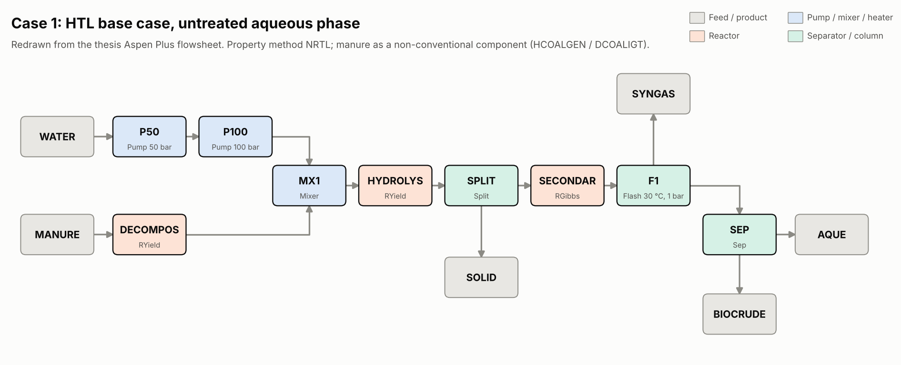

# Aspen Plus models

These files document the three Aspen Plus flowsheets of the thesis so they can be rebuilt, reviewed or reproduced. They are **not** Aspen Plus files (`.bkp` / `.apw`). Those can only be produced by Aspen Plus itself. If you have the original simulation files, add them to this folder.

| File | Contents |
|---|---|
| [`flowsheet_case1.png`](flowsheet_case1.png) | Case 1: HTL base case, untreated aqueous phase (thesis Fig 3.2) |
| [`flowsheet_case2.png`](flowsheet_case2.png) | Case 2: HTL + catalytic hydrothermal gasification (thesis Fig 3.3) |
| [`flowsheet_case3.png`](flowsheet_case3.png) | Case 3: HTL + fractional distillation (thesis Fig 3.4) |
| [`blocks.csv`](blocks.csv) | Every unit operation: Aspen model, role, inlet and outlet streams, conditions |
| [`streams_case1.csv`](streams_case1.csv) | Stream table for the base case (kg/h) |
| [`decompos_calculator.f`](decompos_calculator.f) | Fortran calculator for the DECOMPOS RYield block (thesis Table 3.2.1) |
| [`draw_flowsheets.py`](draw_flowsheets.py) | Redraws the three flowsheet PNGs |

## Model set-up

| Setting | Value |
|---|---|
| Property method | NRTL |
| Manure | Non-conventional component, defined by PROXANAL, ULTANAL and SULFANAL |
| Enthalpy / density of manure | HCOALGEN / DCOALIGT (coal correlations) |
| Feed | 2,000 t/day wet manure (83,333 kg/h), 78.76% moisture |
| Slurry | 20 wt% dry solids (5,167 kg/h make-up water) |
| HTL | 350 °C, 100 bar (Table 3.2.2); SECONDRY RGibbs at 300 °C, 175 bar (Section 3.2) |
| Product separation | Flash F1 at 30 °C, 1 bar; SEP splits biocrude from the aqueous phase |
| Assumptions | Steady state, isothermal, no pressure losses, no kinetics (yield reactors), fixed biocrude composition, no particle-size distribution |

### Case 2: catalytic hydrothermal gasification (CHG)
The aqueous phase is pumped to 200 bar and gasified at 550 °C in an RGibbs reactor (100% conversion of organics to CH₄, CO₂ and NH₃, 99.9% COD removal). It is then flashed at 30 °C and 1 bar into CHG off-gas (≈77% CO₂) and organic-free water.

### Case 3: fractional distillation (RadFrac)
The aqueous phase (COD 650 mg/L) is heated to 30 °C and fed to a RadFrac column. The column has 6 theoretical stages, a molar reflux ratio of 1 and a bottoms rate of 70,259.5 kg/h. The bottoms are water with 99.974 mol% purity and COD < 250 mg/L; the top product is volatile organics, mostly CO₂.

## Rebuilding in Aspen Plus
1. Components: H2O, C (solid), H2, O2, N2, S, CO, CO2, CH4, NH3, H2S, the biocrude model compounds, and non-conventional MANURE and ASH.
2. Enter the manure analysis from [`../data/thesis_tables/manure_analysis_aspen_input.csv`](../data/thesis_tables/manure_analysis_aspen_input.csv).
3. Add the blocks and streams from `blocks.csv`, then the DECOMPOS calculator from `decompos_calculator.f`. Include the sulfur line, so the yields sum to 1.
4. Set HYDROLYS yields so that the products match [`../data/thesis_tables/mass_balance_aspen.csv`](../data/thesis_tables/mass_balance_aspen.csv).

The Python model in [`../src/htlmodel/mass_balance.py`](../src/htlmodel/mass_balance.py) reproduces these mass balances exactly and can be scaled to other feed rates.
